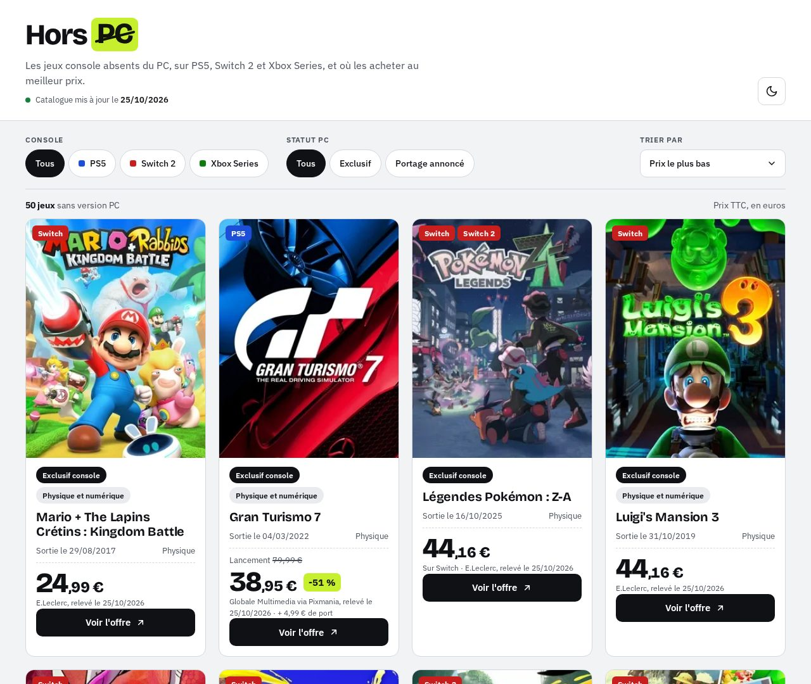
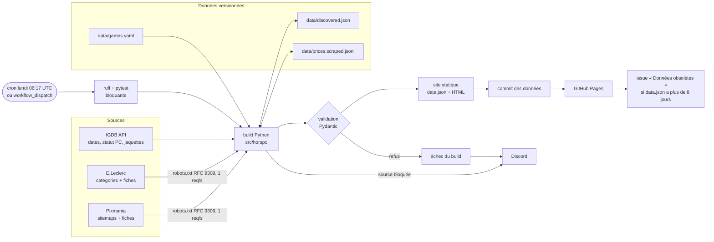

# HorsPC

Catalogue des jeux console absents du PC (PS5, Switch, Switch 2, Xbox Series), avec le prix le plus bas relevé en France, mis à jour chaque semaine par un pipeline GitHub Actions et publié en site statique.

**Site : <https://mvth1s.github.io/hors-pc/>**

[](https://github.com/Mvth1s/hors-pc/actions/workflows/ci.yml)
[](https://github.com/Mvth1s/hors-pc/actions/workflows/update.yml)
[](LICENSE)



## Ce que montre ce projet

- **Pipeline hebdomadaire, tests bloquants avant déploiement** : cron du lundi, ruff et pytest avant tout build, commit des données puis déploiement GitHub Pages ; un push redéploie sans rien commiter. Preuves : [`.github/workflows/update.yml`](.github/workflows/update.yml), [`tests/test_workflows.py`](tests/test_workflows.py) (jobs et étapes exécutés pour chaque événement).
- **Rendu statique et SEO** : HTML complet au build (catalogue lisible sans JS, une page par jeu), JSON-LD `VideoGame` / `Offer` / `AggregateOffer` / `BreadcrumbList`, sitemap avec `lastmod` réels. Preuves : [`src/horspc/render.py`](src/horspc/render.py), [`tests/test_render.py`](tests/test_render.py), section [SEO et rendu statique](#seo-et-rendu-statique).
- **Relevé de prix automatisé et légal** : exception de fouille de textes et de données (TDM) avec une analyse par source, robots.txt interprété selon la RFC 9309 (jokers, règle la plus longue) et relu à chaque run, 1 requête par seconde par site, aucun contournement (une source qui bloque est arrêtée pour le run), règle de plateforme de confiance. Preuves : [`docs/sources.md`](docs/sources.md), [`src/horspc/robots.py`](src/horspc/robots.py), [`src/horspc/prices/fetch.py`](src/horspc/prices/fetch.py), [`src/horspc/prices/trust.py`](src/horspc/prices/trust.py), [`tests/test_robots.py`](tests/test_robots.py), [`tests/test_scraper.py`](tests/test_scraper.py) (pages figées, aucun appel réseau).
- **Consentement CNIL testé en navigateur headless** : aucune requête Google avant accord ni après refus, vérifié avec Playwright sur l'accueil, les pages légales, la FAQ et une page de jeu. Preuves : [`site/consent.js`](site/consent.js), [`tests/test_consent.py`](tests/test_consent.py), section [Mesure d'audience](#mesure-daudience-ga4-conforme-cnil).
- **Alertes** : Discord si le build planifié échoue ou si une source de prix est bloquée (sans faire échouer le build), issue « Données obsolètes » si `data.json` vieillit, diagnostic `scrape_dry_run` de ce que voient les IP de GitHub Actions, audit mensuel des sources (robots.txt, TDMRep, blocages, CGU) qui ouvre une issue à relire sans jamais activer ni désactiver une source. Preuves : jobs `notify` et `freshness` d'[`update.yml`](.github/workflows/update.yml), [`.github/workflows/discord.yml`](.github/workflows/discord.yml), [`.github/workflows/sources-audit.yml`](.github/workflows/sources-audit.yml), [`src/horspc/prices/probe.py`](src/horspc/prices/probe.py), [`src/horspc/audit.py`](src/horspc/audit.py).
- **Schéma de données versionné et validé** : entrées YAML et sortie `data.json` (v6, éditions par console) validées par Pydantic v2 ; un `data.json` précédent d'un autre schéma est refusé. Preuves : [`src/horspc/models.py`](src/horspc/models.py), [`tests/test_build.py`](tests/test_build.py), section [Schéma de `site/data.json`](#schéma-de-sitedatajson-v6).
- **Sécurité des workflows** : permissions minimales par job (`permissions: {}` pour les notifications), toutes les actions épinglées par SHA de commit complet, `actions/*` compris (version en commentaire, mises à jour par [Dependabot](.github/dependabot.yml) avec les dépendances Python via l'écosystème `uv`), aucune expression `${{ github.event.* }}` dans les blocs `run` (événement lu avec `jq`), webhook Discord facultatif. Preuves : [`.github/workflows/`](.github/workflows/), tests `test_discord_*` et `test_toutes_les_actions_epinglees_par_sha` de [`tests/test_workflows.py`](tests/test_workflows.py).

## Architecture (vue d'ensemble)



Un push sur `main` qui touche `site/`, `src/` ou `data/` passe par les mêmes lint et tests, puis redéploie le site en mode hors ligne (sans IGDB ni relevé, sans commit).

## Chiffres clés (25/10/2026)

| Indicateur | Valeur |
|---|---|
| Jeux au catalogue | 50 (57 éditions par console) |
| Jeux avec au moins une offre | 39 / 50 (43 éditions sur 57 ; 8 éditions en rupture affichée) |
| Sources de prix actives | E.Leclerc, Pixmania (Boulanger désactivé, voir [`docs/sources.md`](docs/sources.md)) |
| Tests | 636 (pytest, réseau simulé avec respx, navigateur headless pour le consentement) |

## Documentation

Catalogue web des **jeux console absents du PC** (PS5, Switch, Switch 2, Xbox Series), sortis ou à venir, avec le prix le plus bas relevé en France. Le site est statique (HTML, CSS, JS vanilla) et lit un unique `site/data.json`, régénéré chaque semaine par GitHub Actions puis publié sur GitHub Pages.

- [Architecture](#architecture) (arborescence du code)
- [Lancer en local](#lancer-en-local)
- [Ajouter un jeu](#ajouter-un-jeu) ([candidats IGDB](#trouver-des-candidats))
- [Jeux à venir](#jeux-à-venir)
- [Prix : relevé automatique](#prix--relevé-automatique)
- [Correction d'urgence : prix manuel](#correction-durgence--prix-manuel) ([règle de sélection](#règle-de-sélection))
- [Schéma de `site/data.json`](#schéma-de-sitedatajson-v6) ([jaquettes](#jaquettes))
- [Mise à jour automatique et seuils de fraîcheur](#mise-à-jour-automatique-et-seuils-de-fraîcheur) ([configuration du dépôt](#configuration-du-dépôt-github))
- [SEO et rendu statique](#seo-et-rendu-statique)
- [Mesure d'audience (GA4, conforme CNIL)](#mesure-daudience-ga4-conforme-cnil)
- [Notifications Discord](#notifications-discord)
- [Pages légales](#pages-légales)
- [Crédits](#crédits)
- Sources de prix, cadre légal et preuves : [`docs/sources.md`](docs/sources.md)

## Architecture

Flux de données : [`data/games.yaml`](data/games.yaml) + IGDB + relevé automatique ([`data/prices.scraped.jsonl`](data/prices.scraped.jsonl)) + [`data/prices.manual.yaml`](data/prices.manual.yaml) → [`build.py`](src/horspc/build.py) → validation Pydantic → [`site/data.json`](site/data.json) → [`render.py`](src/horspc/render.py) → HTML statique ; [`site/app.js`](site/app.js) filtre, trie et affiche les prix par console dans le navigateur, sans lire `data.json`.

```text
hors-pc/
├── data/                      # données d'entrée et cache du relevé
│   ├── discovered.json        # EAN et fiches par édition (généré)
│   ├── games.yaml             # jeux et éditions (source de vérité)
│   ├── prices.manual.yaml     # corrections d'urgence (prioritaires)
│   ├── prices.scraped.jsonl   # historique des relevés (généré)
│   ├── redirects.yaml         # anciens slugs → slug actuel
│   ├── sources.audit.yaml     # enseignes de l'audit mensuel
│   └── sources.config.yaml    # sources de prix activées
├── docs/
│   ├── catalogue.jpg          # capture du README
│   ├── maquette/              # maquette du front (non publiée)
│   └── sources.md             # cadre légal, analyse des sources
├── .env.example               # identifiants IGDB (à copier en .env)
├── .github/
│   ├── dependabot.yml         # mises à jour hebdo (actions, uv)
│   └── workflows/
│       ├── ci.yml             # lint + tests (push, PR)
│       ├── discord.yml        # notifications (issues, PR, releases)
│       ├── sources-audit.yml  # audit mensuel des sources
│       └── update.yml         # build hebdo, relevé, Pages, alertes
├── .gitignore
├── LICENSE                    # MIT (code et documentation)
├── NOTICE                     # contenus exclus de la licence
├── pyproject.toml             # dépendances, ruff, pytest
├── .python-version            # Python 3.12
├── README.md
├── scripts/
│   └── og_image.py            # génère site/og-image.png
├── site/                      # site statique publié (GitHub Pages)
│   ├── app.js                 # filtres, tris, prix par console
│   ├── apple-touch-icon.png
│   ├── confidentialite.html   # politique de confidentialité
│   ├── consent.js             # consentement GA4 (CNIL)
│   ├── covers/                # jaquettes WebP (générées)
│   ├── data.json              # catalogue validé (généré)
│   ├── faq.html               # FAQ
│   ├── favicon-32.png
│   ├── favicon.svg
│   ├── fonts/                 # polices auto-hébergées (OFL)
│   ├── game.js                # page de jeu : retour, bande-annonce
│   ├── index.html             # catalogue rendu au build
│   ├── jeux/                  # 50 pages de jeu + 1 redirection, générées
│   ├── mentions-legales.html  # mentions légales
│   ├── methodologie.html      # méthodologie, gabarit des pages de jeu
│   ├── og-image.png           # image de partage 1200 × 630
│   ├── screens/               # captures WebP (générées)
│   ├── sitemap.xml            # plan du site (généré)
│   ├── style.css              # styles, thèmes clair et sombre
│   └── theme.js               # bascule du thème
├── src/
│   └── horspc/
│       ├── audit.py           # audit mensuel des sources
│       ├── build.py           # fusion, validation, data.json
│       ├── candidates.py      # candidats IGDB sans version PC
│       ├── covers.py          # jaquettes et captures IGDB
│       ├── http.py            # client HTTP (UA, retries, 1 req/s)
│       ├── igdb.py            # client IGDB v4
│       ├── __init__.py
│       ├── __main__.py        # CLI
│       ├── models.py          # modèles Pydantic (schéma v6)
│       ├── price_add.py       # saisie d'un relevé manuel
│       ├── prices/            # relevé automatique des prix
│       │   ├── base.py        # interface des fournisseurs
│       │   ├── fetch.py       # robots.txt, blocages
│       │   ├── __init__.py
│       │   ├── manual.py      # prix par édition
│       │   ├── matching.py    # correspondance stricte
│       │   ├── probe.py       # diagnostic scrape_dry_run
│       │   ├── scraper.py     # découverte et relevé
│       │   ├── selection.py   # meilleure offre
│       │   ├── sources.py     # fiches, catégories, sitemaps
│       │   └── trust.py       # plateforme de confiance
│       ├── render.py          # rendu statique, SEO, sitemap
│       ├── robots.py          # robots.txt (RFC 9309)
│       └── stale.py           # jeux sans relevé manuel récent
├── tests/                     # pytest (réseau simulé, headless)
│   ├── conftest.py
│   ├── fixtures/              # réponses IGDB, pages marchandes figées
│   ├── __init__.py
│   ├── test_audit.py
│   ├── test_build.py
│   ├── test_candidates.py
│   ├── test_consent.py
│   ├── test_covers.py
│   ├── test_http.py
│   ├── test_igdb.py
│   ├── test_price_add.py
│   ├── test_render.py
│   ├── test_robots.py
│   ├── test_scraper.py
│   ├── test_selection.py
│   ├── test_site.py
│   ├── test_stale.py
│   ├── test_trust.py
│   └── test_workflows.py
└── uv.lock                    # versions exactes des dépendances
```

## Lancer en local

Prérequis : [uv](https://docs.astral.sh/uv/). Python 3.12 est installé par uv si besoin.

```sh
uv sync
cp .env.example .env          # puis renseigner IGDB_CLIENT_ID et IGDB_CLIENT_SECRET
uv run python -m horspc build # régénère site/data.json
python3 -m http.server -d site 8000   # puis http://localhost:8000
```

Les identifiants IGDB sont ceux d'une application Twitch (<https://dev.twitch.tv/console/apps>). Sans identifiants, `uv run python -m horspc build --offline` reprend les champs IGDB et le `generated_at` du `data.json` existant (ou l'heure courante s'il n'existe pas).

Codes de sortie du build : `0` OK, `1` validation refusée (entrées ou sortie) ou `data.json` précédent présent mais mal formé (JSON invalide, `schema_version` différent du schéma courant, ou contenu refusé par le modèle ; seul un fichier absent est toléré) ; dans les deux cas `data.json` n'est pas modifié, `2` identifiants IGDB manquants.

Tests et lint :

```sh
uv run pytest
uv run ruff check . && uv run ruff format --check .
```

## Ajouter un jeu

**Règle : une entrée de `games.yaml` = un jeu, avec une édition par console sans version PC.** Chaque édition a ses propres EAN, fiches et offres (GTA VI : `ps5` et `xbox_series` ; Zelda Tears of the Kingdom : `switch` et `switch2`, la « Nintendo Switch 2 Edition »). Le site affiche une carte par jeu.

```yaml
- slug: astro-bot                 # kebab-case, unique
  title: Astro Bot
  editions: [{platform: ps5}]     # une par console : ps5 | switch | switch2 | xbox_series
  igdb_id: 255340                 # optionnel : sinon recherche IGDB par titre et plateforme
  launch_price: 69.99             # € TTC, ou null
  launch_price_source: https://…  # obligatoire si launch_price est renseigné
  pc_override:                    # optionnel, prioritaire sur IGDB
    status: none                  # none | announced | released
    source_url: https://…
    checked_at: 2026-10-24
  release_date_override:          # optionnel, prioritaire sur IGDB (date future admise)
    date: 2026-04-30
    source_url: https://…
```

Sans `igdb_id`, le build journalise l'identifiant trouvé (`IGDB : astro-bot → 255340`) et signale les correspondances approximatives : il est conseillé d'épingler alors l'`igdb_id`. Un jeu dont le `pc_status` passe à `released` reste dans `data.json` mais n'est plus affiché ; on peut ensuite le retirer de `games.yaml`.

### Trouver des candidats

`uv run python -m horspc candidates [--limit 50] [--min-ratings 20] [--recent-limit 20] [--include-legacy] [--output data/candidates.yaml]` interroge IGDB et écrit un YAML au format de `games.yaml`, **à curer à la main** (le fichier est ignoré par git ; la commande refuse d'écrire dans `games.yaml`).

- Jeux sur PS5, Switch, Switch 2 ou Xbox Series (ids lus par slug via `/platforms` : `ps5`, `switch`, `switch-2`, `series-x-s`), de type Main Game, Remake ou Remaster (ids lus via `/game_types`), hors éditions (`version_parent`), absents de `games.yaml`.
- Exclusion PC avec la même logique que `pc_status`, appliquée à la fiche, à ses fiches liées (`remasters`, `remakes`, `ports`, `expanded_games`, `standalone_expansions`) et à ses éditions, ainsi qu'au jeu d'origine (`parent_game`) pour un Remaster ou un Port (même jeu), mais pas pour un Remake (autre jeu) : seul un jeu **released** sur PC est écarté ; un portage annoncé reste candidat, signalé en commentaire.
- Première sortie sur PS5, Switch, Switch 2 ou Xbox Series (les originaux PS4, Wii U, GBA… ressortis sur ces consoles sont écartés, sauf `--include-legacy`). `platforms` reprend les consoles de cette première sortie.
- Deux sections : les plus notés (`total_rating_count`, seuil `--min-ratings`), puis « Sorties récentes » des 365 derniers jours triées par `hypes`, sans seuil (le champ `follows` n'est plus renseigné par IGDB).

## Jeux à venir

Un jeu dont `release_date` est future reste au catalogue (tant qu'aucune version PC n'est sortie) avec un badge « Sortie le JJ/MM/AAAA », en plus de son statut PC. La date de référence est celle du build ; entre deux builds, `app.js` et `game.js` retirent le badge dès que la date est passée (date locale du visiteur). Grand Theft Auto VI (19/11/2026) est référencé dans son édition PS5 ; l'édition Xbox Series ferait une seconde entrée (une entrée = une référence achetable).

## Prix : relevé automatique

Chaque build complet (cron du lundi et `workflow_dispatch`, jamais sur push ni `--offline`) relève les prix sur les sources activées dans `data/sources.config.yaml` : **E.Leclerc, Pixmania** (Boulanger désactivé : HTTP 400 depuis les IP de GitHub Actions). Cadre légal, preuves et sources exclues : [docs/sources.md](docs/sources.md). Aucune saisie : ni prix, ni URL, ni EAN.

- **Découverte** (sans URL saisie, uniquement par des chemins autorisés par robots.txt), dans cet ordre : pages catégories E.Leclerc (`/cat/jeux-ps5`, `jeux-switch`, `jeux-switch-2`, `jeux-xbox-series`, retrouvées dans le sitemap de navigation ; nom et EAN de chaque carte, `gtin13` vérifié sur la fiche), sitemaps produits de Pixmania (slugs lisibles, EAN lu dans le `gtin13` de la fiche), puis fiche E.Leclerc ouverte directement par un EAN venu de Pixmania (`/fp/x-<EAN>`, le site redirige vers la fiche). Une catégorie n'est lue que si une de ses éditions attend une découverte, au plus une fois par run (au pire 138 pages, environ 2 min 20 et 115 Mo ; aucune quand tout est trouvé). Pagination `?page=N` jusqu'à une page vide, sans tri ni filtre (interdits par robots.txt, lignes 14 à 23) ; elle est instable (pages répétées), et un produit manqué est recherché à nouveau 14 jours plus tard. Détails : [docs/sources.md](docs/sources.md). La recherche interne de Leclerc est interdite par son robots.txt et ses sitemaps ne contiennent que des URL `/fp/<EAN>`, sans titre : c'est pourquoi l'EAN vient des pages catégories ou de Pixmania (ou du cache, pour les EAN trouvés via Boulanger avant sa désactivation). Les EAN (un ensemble par jeu : Mario Kart World en a deux selon les enseignes) et les URL sont mis en cache dans `data/discovered.json` ; une recherche infructueuse n'est relancée qu'après 14 jours, une fiche disparue (404) est recherchée à nouveau.
- **Boîte avec code** : un produit dont le nom mentionne « code in a box », « code dans la boîte », « code de téléchargement », « digital code »…, ou dont la description JSON-LD dit explicitement que la boîte ne contient qu'un code (« ne contiendra qu'un code », « aucun disque ne sera inclus »), prend le format `code_box`, affiché « Boîte avec code de téléchargement ». Une simple mention d'un code dans la description (bonus, pack console) ne suffit pas.
- **Correspondance stricte** : même EAN, ou titre + plateforme + édition standard (aucun mot en trop hors liste blanche : « deluxe », « collector », « pack », « steelbook », « code de téléchargement »… rejettent l'offre). Les noms alternatifs IGDB (`alternative_names`) sont acceptés comme titres (« GTA VI »), et les éditeurs et studios IGDB du jeu comme mots tolérés (« Sony Interactive Entertainment SAROS »). Sur Pixmania, un nom de produit sans plateforme prend celle du slug de l'URL, à condition que le slug en cite exactement une et que ce soit celle de l'entrée (`saros-ps5-528089`). Un nom avec un mot inconnu en tête (« Microids Astro Bot ») n'est rattaché que par un EAN déjà connu du jeu.
- **Limite** : les EAN de Pixmania (souvent des imports) ne correspondent pas toujours à ceux de Leclerc (Mario Kart World : `0045496312329` chez Pixmania, `0045496312336` chez Leclerc). Un jeu absent des catégories Leclerc (pagination instable, rupture) peut donc n'avoir que le prix Pixmania, voire aucun prix ; au 25/10/2026, 39 jeux sur 50 ont une offre.
- **Lecture** : JSON-LD `Product`/`Offer` (prix, devise, état, disponibilité, `gtin13`) ; vendeur dans le JSON-LD (Leclerc) ou le HTML (Boulanger, Pixmania).
- **Règle de plateforme de confiance** (`prices/trust.py`) : neuf, livrable en France, vendeur professionnel (l'enseigne, ou un vendeur de la place de marché de Pixmania, réservée aux pros), plateforme établie dans l'UE, jamais de revendeur de clés. Offre refusée sinon, ou sans vendeur identifié, ou indisponible.
- **Politesse** : User-Agent `HorsPC/<version> (+https://github.com/Mvth1s/hors-pc)`, robots.txt relu à chaque run (y compris après une redirection), 1 requête par seconde au plus par hôte, timeouts, nouvel essai sur 5xx uniquement. Une réponse 400, 401, 403, 429, une page de défi (captcha, anti-bot) ou un robots.txt non vérifiable (tout code autre que 200, 404 et 410, ou erreur réseau) marque la source **bloquée pour le run** : plus aucune requête, pas de nouvel essai, aucun contournement (ni proxy, ni changement d'User-Agent, ni navigateur headless, ni résolution de captcha).
- **Rupture** : une fiche trouvée sans offre en ligne est mémorisée dans `discovered.json` (`out_of_stock`, date du dernier constat) et relevée à chaque run ; sans autre offre, le site affiche « En rupture chez E.Leclerc, constaté le JJ/MM/AAAA » (`editions[].out_of_stock` dans `data.json`), et le prix réapparaît au retour du stock.
- **Historique** : chaque relevé est ajouté à `data/prices.scraped.jsonl` (une ligne par jeu, source et jour), versionné avec le site.
- **Bilan** : `--scrape-report <fichier>` écrit le bilan du run (relevés, sources bloquées, fiches sans JSON-LD, événements). `--no-scrape` fait un build complet sans relevé.
- **Diagnostic depuis GitHub Actions** : Actions › Mise à jour › Run workflow, en cochant `scrape_dry_run`. Le job `probe` remplace alors le build (ni commit, ni déploiement, ni issue de fraîcheur) et écrit dans le résumé du run, pour chaque source activée, ce que voient les IP de GitHub Actions : robots.txt, code HTTP, page de défi éventuelle, JSON-LD lu (prix, vendeur), avec les mêmes règles que le relevé. En local : `uv run python -m horspc scrape-probe`.

Dans `data.json`, `offer.source` vaut `scraped` ou `manual`, et `offer.seller` nomme le vendeur pro d'une place de marché (`null` quand c'est l'enseigne) : le site affiche alors « ShopVite via Pixmania ».

## Correction d'urgence : prix manuel

`data/prices.manual.yaml` ne sert qu'à corriger un relevé automatique erroné ; rien sur le site n'en dépend. Un relevé manuel est **prioritaire** sur un relevé automatique de la même édition, du même marchand et du même jour. Champ `platform` : obligatoire si le jeu a plusieurs éditions, facultatif sinon. Les anciennes observations restent : elles forment l'historique.

`uv run python -m horspc price add` guide la saisie : jeu (liste numérotée ou slug, complétion avec Tab), édition (si le jeu en a plusieurs), marchand (liste blanche), format (déduit du marchand), prix, port (vide = inconnu), vente par l'enseigne (refus explicite sinon) et URL. `observed_at` vaut la date du jour. Le relevé est validé avec les mêmes modèles que le build et ajouté en fin de fichier, commentaires et ordre préservés (ruamel.yaml) ; rien n'est écrit si la validation échoue.

`uv run python -m horspc stale` liste les jeux à relever : sans aucun relevé, ou dont l'offre retenue est `stale` (aucun relevé de moins de 30 jours). Ils sont triés du plus ancien dernier relevé au plus récent (sans relevé en tête), avec la date et l'URL du dernier relevé et le dernier relevé de chaque marchand.

```yaml
- slug: astro-bot
  price: 53.30              # € TTC, article seul
  shipping: null            # frais de port en € ; 0 = offerts ; null = inconnus
  format: physical          # physical | digital
  condition: new
  merchant: amazon          # identifiant de la liste blanche ci-dessous
  sold_by_merchant: true    # vendu par l'enseigne elle-même, pas par un vendeur tiers
  url: https://www.amazon.fr/dp/…
  observed_at: 2026-10-20
```

Marchands admis (`MERCHANTS` dans `src/horspc/models.py`), le domaine de `url` devant correspondre :

| Format | Identifiants |
|---|---|
| physical | `amazon`, `cdiscount` (ecommerce) ; `fnac`, `darty`, `boulanger`, `cultura` (culture_tech) ; `micromania` (specialiste) ; `leclerc`, `auchan` (grande_distribution) |
| digital (officiel uniquement) | `playstation-store`, `nintendo-eshop` (store_officiel) |

Chaque marchand a une `category` (`grande_distribution`, `specialiste`, `culture_tech`, `ecommerce`, `store_officiel`).

**Règle : un relevé n'est valable que si le prix est accessible partout en France en livraison à domicile** (pas de prix de drive, de retrait ou de magasin). Enseignes écartées : Intermarché et Super U (prix du magasin choisi, livraison selon le magasin), Carrefour (aucune fiche de jeu vendue par Carrefour lui-même trouvée), Lidl (pas de jeux PS5/Switch en ligne).

Sont refusés à la validation, avec un message explicite : les marketplaces (`rakuten`, `ebay`), les revendeurs de clés (Instant Gaming, Eneba, G2A, Kinguin, CDKeys, Gamivo, K4G, HRK, etc.), toute observation avec `sold_by_merchant: false`, un marchand inconnu, une URL hors du domaine du marchand, et une date future.

### Règle de sélection

1. Pour chaque couple (marchand, format), seul le relevé le plus récent compte.
2. Parmi les relevés de **moins de 30 jours** : le **physique neuf** le moins cher ; à défaut, la **boîte avec code de téléchargement** (`code_box`) la moins chère ; à défaut, le **démat officiel** le moins cher.
3. La comparaison porte sur `price + shipping` quand le port est connu, sinon sur `price` seul.
4. Sans relevé récent : le relevé le plus récent, marqué `stale: true` (« Prix à vérifier » sur le site).
5. Égalité : relevé le plus récent, puis ordre alphabétique du marchand.

`discount_pct` = `round(100 × (1 − price / launch_price))`, port exclu ; `null` sans prix de lancement. Le badge n'est affiché que si la réduction est positive.

## Schéma de `site/data.json` (v6)

Montants en centimes (entiers), dates ISO 8601, horodatages UTC (`Z`). Le formatage (`53,30 €`, `JJ/MM/AAAA`) est fait par le front. Le modèle de référence est `DataFile` dans `src/horspc/models.py`.

```json
{
  "schema_version": 6,
  "generated_at": "2026-10-26T06:17:42Z",
  "currency": "EUR",
  "games": [
    {
      "slug": "astro-bot",
      "title": "Astro Bot",
      "platforms": ["ps5"],
      "release_date": "2024-09-06",
      "release_date_source": "igdb",
      "launch_price_cents": 6999,
      "igdb_id": 255340,
      "igdb_url": "https://www.igdb.com/games/astro-bot",
      "igdb_fetched_at": "2026-10-26T06:17:40Z",
      "cover_url": "covers/astro-bot.webp",
      "cover_image_id": "coba3k",
      "pc_status": "none",
      "pc_status_source": "igdb",
      "developers": ["Team Asobi"],
      "publishers": ["Sony Interactive Entertainment"],
      "summary": "Buckle up for some epic PlayStation camaraderie…",
      "summary_source": "igdb",
      "screenshots": [{"image_id": "scsiqf", "url": "screens/astro-bot/scsiqf.webp"}],
      "trailer_youtube_id": "wHMNQzLG_Jg",
      "editions": [
        {"platform": "ps5", "offer": {"platform": "ps5", "price_cents": 5330, "…": "…"},
         "sold_digital": true, "listed_physical": true}
      ],
      "best_offer": {
        "platform": "ps5",
        "price_cents": 5330,
        "shipping_cents": null,
        "discount_pct": 24,
        "format": "physical",
        "condition": "new",
        "merchant": "Pixmania",
        "seller": "ShopVite",
        "url": "https://www.pixmania.com/fr/fr/…",
        "observed_at": "2026-07-18",
        "source": "scraped",
        "stale": true
      }
    }
  ]
}
```

- `release_date` : plus ancienne sortie sur l'une des plateformes du jeu, parmi les dates IGDB en région `europe` ou `worldwide` et au statut « Full Release » ou sans statut (accès anticipé, Advanced Access, alpha, bêta, etc. sont écartés). Les ids de région et de statut sont lus par leur nom via `/release_date_regions` et `/release_date_statuses`. Si aucune date ne passe ces filtres, le build journalise un WARNING (slug, nombre de dates écartées par motif) : ajouter alors un `release_date_override`.
- `release_date_source` : `igdb`, `manual` (`release_date_override`) ou `null` si `release_date` est `null`. Ajouté en v2.
- `pc_status` : déduit des `release_dates` PC d'IGDB (toutes régions), les lignes au statut Cancelled étant ignorées. `released` si une ligne Full Release, Early Access, Advanced Access, Offline ou sans statut a une date passée ; `announced` pour toute autre ligne retenue (date future ou absente, ou statut Alpha, Beta…) ; `none` si aucune ligne PC n'est retenue, même si le PC figure dans les plateformes du jeu. `pc_status_source` vaut `manual` quand `pc_override` est utilisé.
- L'identifiant de la plateforme PC n'est pas codé en dur : il est lu via l'endpoint `platforms` d'IGDB (slug `win`).
- Si IGDB est injoignable, les champs IGDB (dont `igdb_fetched_at`) sont repris du `data.json` précédent ; le build n'échoue pas.
- `editions[].sold_digital` / `editions[].listed_physical` : preuves IGDB tirées d'`external_games` pour la plateforme de l'édition (vente sur un store officiel ou Amazon au format Digital ; entrée au format Physical). Le badge « Physique et numérique » n'est affiché que si `sold_digital` est vrai **et** qu'une preuve physique existe (`listed_physical`, ou une offre `physical` relevée ; une `code_box` ne compte pas). Aucun autre badge de format (jamais « Numérique uniquement » ni « Physique uniquement ») : l'absence d'une entrée IGDB ne prouve pas l'absence d'une édition. Champs ajoutés en v5 avec `false` par défaut.
- `editions` (v6) : une par console, avec son offre (`null` sans relevé) et ses preuves de format ; `platforms` en est dérivé (filtres) ; `best_offer` est la meilleure offre toutes éditions, avec sa `platform` : à jour avant « Prix à vérifier », puis physique, boîte avec code, démat, puis prix port compris.
- `offer.seller` : vendeur professionnel d'une place de marché (« ShopVite » sur Pixmania), `null` quand l'enseigne vend elle-même ; `offer.source` : `scraped` (relevé automatique) ou `manual` (correction d'urgence). Ajoutés en v5.
- `cover_url` : chemin relatif `covers/<slug>.webp`, ou `null` sans jaquette ; `cover_image_id` : `image_id` IGDB de la jaquette présente sur disque. Ajoutés en v3. Le site ne charge jamais d'image depuis `images.igdb.com`.

### Jaquettes

- Au build complet, `covers.py` récupère l'`image_id` de la cover IGDB de chaque jeu et télécharge `t_cover_big` (264 × 352) **directement en WebP** : IGDB sert ce format quand on demande l'extension `.webp`, aucune conversion ni dépendance n'est nécessaire. Le contenu est vérifié (en-tête `RIFF…WEBP`).
- Le fichier n'est retéléchargé que si l'`image_id` a changé par rapport au `data.json` précédent, ou s'il manque. En cas d'échec, l'ancien fichier est conservé ; si IGDB n'a plus de cover, le fichier est supprimé, ainsi que les jaquettes de jeux retirés du catalogue.
- Les fichiers ne sont écrits qu'après validation et écriture de `data.json` : un build refusé ne touche pas `site/covers/`.
- En `--offline` (ou si IGDB est indisponible), les fichiers déjà présents sont réutilisés tels quels ; rien n'est téléchargé ni supprimé.
- Le front affiche la jaquette (`width`/`height`, `loading="lazy"`) et retombe sur le visuel à initiales, avec la mention « Visuel provisoire », si `cover_url` est `null`.

## Mise à jour automatique et seuils de fraîcheur

`.github/workflows/update.yml` se comporte différemment selon l'événement :

| Événement | Build | Commit de `data.json` et `site/covers/` | Déploiement Pages | Job `freshness` |
|---|---|---|---|---|
| `schedule` (**lundi 06:17 UTC**) et `workflow_dispatch` | complet, avec IGDB (secrets) | oui, s'il a changé | oui | oui |
| `push` sur `main` touchant `site/`, `src/` ou `data/` | `--offline` (sans IGDB ni secrets) | **jamais** | oui, avec le `data.json` ainsi généré | non |

Sur un push, le site est donc redéployé avec les prix et le code à jour, mais les champs IGDB viennent du `data.json` versionné. Ce `data.json` régénéré n'existe que dans l'artefact déployé : le dépôt n'est modifié que par le build planifié ou manuel. Le build `--offline` reprend aussi le `generated_at` du `data.json` versionné : un push ne rajeunit donc pas la date « Catalogue mis à jour le » et ne masque pas la bannière d'ancienneté, qui reflètent toujours le dernier build complet. Seul `offer.stale` est recalculé avec l'heure courante, si bien qu'un relevé peut passer en « Prix à vérifier » après un push.

Deux garde-fous vérifient qu'un push ne produit aucun commit du bot :

- `tests/test_workflows.py` évalue les conditions `if:` de `update.yml` pour chaque événement. Il vérifie que, sur un push, aucune étape exécutée ne contient `git commit` ou `git push`, que le seul build lancé est `--offline` sans secret, et que `freshness` ne tourne pas.
- Dans le workflow, l'étape « Vérifie qu'un push ne produit aucun commit » échoue si `HEAD` diffère du commit poussé.

Si la validation échoue, rien n'est commité ni déployé.

Deux seuils, volontairement distincts :

| Constante | Valeur | Où | Effet |
|---|---|---|---|
| `STALE_ISSUE_DAYS` | **8 jours** | `env` de `.github/workflows/update.yml` | ouvre une issue « Données obsolètes » (label `stale-data`, une seule à la fois) |
| `STALE_BANNER_DAYS` | **14 jours** | en tête de `site/app.js` | affiche une bannière d'alerte sous l'en-tête du site |

Le job d'alerte tourne même quand le build échoue (sur `schedule` et `workflow_dispatch` uniquement). Il ne peut pas, en revanche, détecter un cron désactivé par GitHub (après 60 jours sans activité sur le dépôt) : le commit hebdomadaire de `data.json` maintient normalement le dépôt actif, et la bannière du site reste le garde-fou indépendant d'Actions.

### Configuration du dépôt GitHub

1. Secrets `IGDB_CLIENT_ID` et `IGDB_CLIENT_SECRET` (Settings > Secrets and variables > Actions).
2. Source GitHub Pages sur « GitHub Actions » :

   ```sh
   gh api -X POST repos/Mvth1s/hors-pc/pages -f build_type=workflow
   # si Pages est déjà activé avec une autre source :
   gh api -X PUT repos/Mvth1s/hors-pc/pages -f build_type=workflow
   ```

## SEO et rendu statique

Le build (complet ou `--offline`) écrit le catalogue en HTML : le site est **entièrement lisible sans JavaScript** ; `app.js` ne gère plus que les filtres, les tris et la bannière d'ancienneté sur les fiches déjà présentes, et plus aucune page ne charge `data.json`.

- `index.html` reste le gabarit : le build ne remplace que les zones `<!--horspc:head-->`, `updated`, `count` et `grid`. Les pages racine reçoivent leur zone `head` et la date du catalogue dans le pied de page.
- Carte : un badge par console ; prix = meilleure offre toutes éditions, avec « Sur PS5 » si le jeu a plusieurs éditions. Avec un filtre console actif, le prix affiché et le tri suivent la meilleure offre des éditions de cette console (filtre Switch 2 = éditions `switch` et `switch2`) : les blocs par filtre sont rendus au build (`data-views`), `app.js` ne fait que les afficher. Format court sur les cartes (« Code dans la boîte »).
- Page de jeu : « Offre retenue » (meilleure offre), puis tableau « Prix par édition » (console, prix, format, marchand, date, lien) ; JSON-LD `AggregateOffer` (lowPrice, highPrice, offerCount) si plusieurs éditions ont une offre à jour, `Offer` sinon.
- Une page par jeu : `site/jeux/<slug>/index.html` (titre, plateformes, date, statut PC, offre retenue et date de relevé, jaquette, lien vers le catalogue), construite sur le gabarit des pages légales. Les pages des jeux retirés sont supprimées.
- Page de jeu enrichie au build complet depuis IGDB : studio(s) et éditeur(s) (`involved_companies`), résumé (`summary`, affiché en anglais avec la mention « Résumé IGDB (en anglais) », ou `description_fr` de `games.yaml` s'il est renseigné), jusqu'à 4 captures officielles (`t_screenshot_big`, WebP dans `site/screens/<slug>/<image_id>.webp`, retéléchargées seulement si l'`image_id` change, réutilisées hors ligne) et la bande-annonce (première vidéo IGDB dont le nom contient « trailer »). La bande-annonce est une façade (image + bouton, `game.js`) : l'iframe `youtube-nocookie.com` n'est créée qu'au clic, aucune requête vers YouTube avant (test Playwright). `data.json` passe en `schema_version` 4 (`developers`, `publishers`, `summary`, `summary_source`, `screenshots`, `trailer_youtube_id`).
- Cartes du catalogue entièrement cliquables (lien du titre étendu à toute la carte, « Voir l'offre » reste au-dessus), légère élévation au survol et au focus, désactivée avec `prefers-reduced-motion`.
- Sur chaque page : `<link rel="canonical">` absolu, meta description, Open Graph et Twitter card (jaquette, ou `site/og-image.png` en 1200 × 630, générée par `uv run python scripts/og_image.py` avec les polices et les tokens de `style.css`), `lang="fr"`, un seul `h1`. Un test vérifie que tout fichier local référencé par une page (src, href, `og:image`, `twitter:image`, polices de `style.css`) existe.
- JSON-LD : `WebSite`, `Person` et `ItemList` sur l'accueil ; `VideoGame` sur chaque page de jeu, avec une `Offer` (prix, EUR, `priceValidUntil` = date du relevé + 30 jours, `InStock`, `NewCondition`) seulement si l'offre n'est pas `stale` : au-delà de 30 jours, le prix n'est plus garanti et n'est plus publié. Le stock n'est pas suivi : `InStock` signifie « offre disponible au moment du relevé ».
- `site/sitemap.xml` : accueil, pages racine et pages de jeux. `lastmod` réel : date du catalogue pour l'accueil, date « Dernière mise à jour » affichée pour les pages statiques, et pour une page de jeu la date du build où son contenu (`<main>`) a changé pour la dernière fois.
- Vérification Google Search Console : balise `google-site-verification` dans le `<head>` d'`index.html` uniquement (un test garantit qu'elle ne disparaît pas).

**Pas de `robots.txt` dans `site/`.** Les robots ne lisent `robots.txt` qu'à la racine du domaine (`https://mvth1s.github.io/robots.txt`), jamais dans un sous-chemin comme `/hors-pc/`. Deux options pour en avoir un :

1. **Domaine personnel** : configurer un domaine pour GitHub Pages ; le site est alors servi à la racine, `site/robots.txt` y serait lu (avec `Sitemap: https://<domaine>/sitemap.xml`). Les URL absolues (`SITE_URL` dans `src/horspc/render.py`) sont à mettre à jour.
2. **Dépôt `Mvth1s.github.io`** : il sert la racine `https://mvth1s.github.io/` ; y placer un `robots.txt` contenant `Sitemap: https://mvth1s.github.io/hors-pc/sitemap.xml`.

En attendant, déclarer `https://mvth1s.github.io/hors-pc/sitemap.xml` directement dans Search Console.

## Mesure d'audience (GA4, conforme CNIL)

`site/consent.js`, chargé sur toutes les pages, gère Google Analytics 4 (`G-TMFL6HQ430`) **sans le snippet standard de Google** :

- Aucun script ni requête Google avant un clic sur « Accepter » (pas de Consent Mode) : `gtag.js` est alors injecté dynamiquement, puis `gtag('config', …)` avec `allow_google_signals: false`, `allow_ad_personalization_signals: false` et des cookies `_ga` limités à 13 mois.
- Bandeau à la première visite : finalité, destinataire (Google, transferts hors UE), boutons « Refuser » et « Accepter » identiques, aucune case pré-cochée ; fermer (× ou Échap) vaut refus.
- Choix stocké en `localStorage` (`horspc-consent`, avec sa date), redemandé au bout de 6 mois.
- Lien « Gérer les cookies » (pied de page, FAQ, confidentialité) : rouvre le bandeau ; un retrait supprime les cookies `_ga*` et recharge la page sans GA.
- `tests/test_consent.py` (Playwright, Chromium headless, requêtes Google simulées) : aucune requête externe avant consentement ni après refus sur toutes les pages, `gtag.js` chargé après acceptation et aucun autre domaine, boutons de même taille, nouvelle demande après 6 mois, retrait. En local : `uv run playwright install --only-shell chromium` une fois.

## Notifications Discord

Tout passe par GitHub Actions et le secret `DISCORD_WEBHOOK_URL` (plus de webhook GitHub → Discord, qui s'affichait sous le nom « GitHub »). Aucun champ `username` n'est envoyé : c'est le nom du webhook configuré côté Discord qui apparaît. Si le secret est absent, rien n'est envoyé.

- **Activité du dépôt** (`.github/workflows/discord.yml`) : issues ouvertes, fermées ou rouvertes, nouveaux commentaires, PR ouvertes, fermées, fusionnées ou rouvertes (`pull_request_target`), versions publiées. Message en embed : type d'événement, numéro et titre, auteur, lien, extrait du corps ; couleur selon l'action (vert ouverture, rouge fermeture, orange réouverture, violet fusion). Les issues et commentaires créés par `github-actions[bot]` (alerte de fraîcheur) sont ignorés.
- **Échec du build planifié ou manuel** : le job `notify` d'`update.yml` (`if: failure()`, événements `schedule` et `workflow_dispatch`) poste le nom du workflow, l'événement et le lien du run. Un échec sur un simple push n'envoie rien : la CI le signale déjà sur le commit. Pour tester cette alerte : Actions › Mise à jour › Run workflow, en cochant `test_notification` ; la première étape du build échoue alors volontairement, avant tout build, commit et déploiement.
- **Relevé des prix incomplet** : après le build complet, l'étape « Alerte Discord si une source est bloquée ou cassée » lit le bilan du relevé (`horspc scrape-report`) et poste un message si une source a été bloquée (401, 403, 429, page de défi) ou si une fiche n'a plus de JSON-LD exploitable. Cette étape ne fait jamais échouer le build (`continue-on-error`, envoi en échec simplement signalé) : les autres sources et le site sont mis à jour normalement. Le même bilan est écrit dans le résumé du run.
- **Audit mensuel des sources** ([`sources-audit.yml`](.github/workflows/sources-audit.yml), le 1er du mois ou à la demande) : `uv run python -m horspc sources-audit` contrôle, depuis les IP de GitHub, robots.txt, TDMRep, blocages, empreinte des clauses des CGU et JSON-LD des sources actives pour chaque enseigne de [`data/sources.audit.yaml`](data/sources.audit.yaml). L'état de référence `data/sources.audit.json` est commité par le bot ; un changement ouvre l'issue « Audit des sources : changements à relire » (label `sources-audit`, une seule ouverte) et envoie un message Discord, sinon un résumé va dans le résumé du run. Aucune source n'est activée ni désactivée automatiquement. Détails et contacts officiels pour une demande d'autorisation : [`docs/sources.md`](docs/sources.md#audit-mensuel).

Sécurité de `discord.yml` : `permissions: {}`, aucun checkout (le code d'une PR, même venant d'un fork, n'est jamais exécuté avec `pull_request_target`), aucune expression `${{ github.event.* }}` dans les scripts (l'événement est lu par `jq` dans `$GITHUB_EVENT_PATH` et le JSON construit par `jq`), `allowed_mentions: {parse: []}`, titres tronqués à 256 caractères et extraits à 300. `tests/test_workflows.py` vérifie ces règles et le contenu des embeds.

## Pages légales

`site/faq.html` (questions en `<details>`, JSON-LD `FAQPage`), `site/mentions-legales.html`, `site/confidentialite.html` et `site/methodologie.html` sont statiques et liées depuis le pied de page de toutes les pages. `tests/test_site.py` vérifie qu'aucune page ne charge de ressource externe, que le pied de page lie les trois pages et qu'elles sont datées. **TODO bloquant** : `test_adresse_de_contact_renseignee` échoue tant que l'adresse de contact de l'éditeur n'est pas renseignée dans `mentions-legales.html`.

## Crédits

- Dates de sortie, statut PC et jaquettes : [IGDB.com](https://www.igdb.com), attribution dans le pied de page commun de chaque page (« Données de jeux et jaquettes via IGDB.com »), ainsi que dans les mentions légales, la FAQ et les pages de jeu (résumé IGDB). Les jaquettes et noms de jeux appartiennent à leurs éditeurs respectifs ; une demande de retrait peut être faite via une issue GitHub (lien dans le pied de page).
- Polices auto-hébergées (aucun appel à Google Fonts) : Bricolage Grotesque et IBM Plex Sans, sous licence SIL Open Font License 1.1 (`site/fonts/OFL-*.txt`).
- HorsPC n'est affilié à aucun constructeur, éditeur ni marchand.
- Licence : [MIT](LICENSE) pour le code et la documentation ; jaquettes, captures (`site/covers/`, `site/screens/`), noms de jeux, marques et données IGDB en sont exclus (voir [`NOTICE`](NOTICE)).
